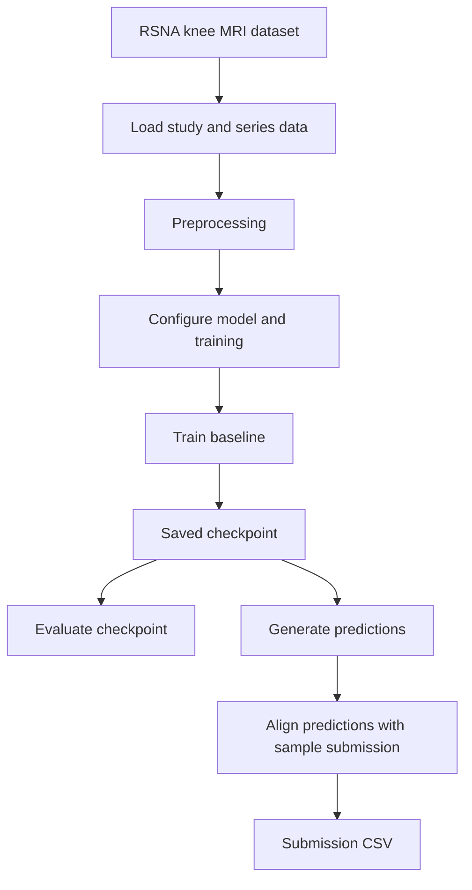
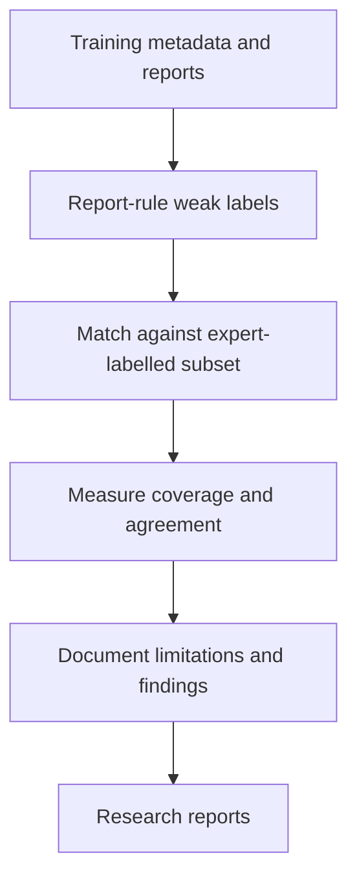

# RSNA Knee Abnormality Detection

[](https://github.com/Chetan-code-lrca/rsna-knee-public/actions/workflows/tests.yml) [](https://github.com/Chetan-code-lrca/rsna-knee-public/releases/latest)

Research code and experiment records for the RSNA Knee Abnormality Detection competition: predicting twelve abnormalities for each knee MRI study.

> **Research prototype only. Not for clinical diagnosis.**

## Competition outcome

The competition has completed. Based on the Kaggle leaderboard screenshots reviewed on 2026-10-27, the final participant/team result was **private rank 2,381 with score 0.935**. The public leaderboard showed **rank 2,465 with public AUC 0.950**.

Individual scored submissions recorded on the Submissions page:

| Candidate | Public AUC | Outcome |
|---|---:|---|
| S6 ConvNeXt reproduction/adaptation | **0.950** | Completed and selected |
| Reference Ensemble Evaluation | **0.943** | Completed and selected |
| Original weak-supervision baseline | 0.636 | Completed; not selected |
| Constant-0.5 fallback | No competitive score | Format/schema check only |

The private leaderboard result is the participant/team's final result; it is not a verified private score for each individual notebook. The S6 entry is an attributed reproduction/adaptation of public work and third-party weights, not an independently created architecture/checkpoint.

Read the [final competition results](reports/competition-final-results-2026-10-27.md), [final experiment report](reports/final-experiment-report.md), [model provenance and attribution](reports/model-provenance.md), [weak-label audit method](reports/weak-label-audit-method.md), [weak-label audit results](reports/weak-label-audit-results.md), [baseline diagnosis](reports/experiment-diagnosis.md), [submission checklist](docs/competition-submission-checklist.md), and [public-release audit](reports/public-release-audit.md).

## Competition task and metric

Predict a probability for each target per `StudyInstanceUID`:

`ACL`, `MCL`, `Medial Meniscus`, `Lateral Meniscus`, `Medial OA`, `Lateral OA`, `PF OA`, `Effusion`, `Synovitis`, `Baker's`, `Contusion`, and `Fracture`.

The official metric is macro-averaged ROC AUC across the twelve target columns. See the [official evaluation page](https://www.kaggle.com/competitions/rsna-knee-abnormality-detection/overview/evaluation) and [official rules](https://www.kaggle.com/competitions/rsna-knee-abnormality-detection/rules).

## Repository layout

- `configs/`: dataset, model, training and inference configuration.
- `src/`: data loading, preprocessing, model and training helpers.
- `scripts/`: report analysis, download, training, evaluation, prediction and submission helpers.
- `tests/`: unit tests; they do not download competition data.
- `kaggle/rsna_knee_submission.ipynb`: original offline weak-supervision baseline.
- `kaggle/rsna_knee_weak_label_audit/`: CPU-only audit of report-rule labels against the expert-labelled training subset.
- `kaggle/rsna_knee_safe_fallback/`: CPU-only format fallback (constant 0.5; not competitive).
- `reports/`: experiment results, final leaderboard outcome, provenance and research methods.
- `CITATION.cff`: citation metadata used by GitHub's “Cite this repository” feature.

Large DICOM data and checkpoints should remain outside Git unless redistribution is needed and permitted by their terms.

## Project workflow

The repository contains two related workflows: a reproducible local baseline pipeline and a set of research/competition artifacts. They are connected by the same knee MRI task, but they should not be treated as one identical training run.

### 1. End-to-end baseline pipeline

This is the local workflow exposed by the training, evaluation, prediction and submission scripts:



| Stage | What happens | Where to look |
|---|---|---|
| Configure | Review dataset, model, training and inference settings | `configs/` |
| Prepare | Load and preprocess the MRI study/series inputs | `src/` |
| Train | Run the local baseline training entry point | `scripts/train.py` |
| Evaluate | Measure a saved checkpoint | `scripts/evaluate.py` |
| Predict | Generate target probabilities from a checkpoint | `scripts/predict.py` |
| Submit | Format predictions against the competition template | `scripts/submit.py` |

### 2. Research and validation workflow

The weak-label audit is a separate analysis path. It checks report-derived rule labels against the subset with expert labels; its coverage-limited results should not be interpreted as full-dataset diagnostic performance.



The competition notebooks and experiment reports also record the S6 ConvNeXt reproduction/adaptation and Reference Ensemble evaluation. Those scored competition artifacts are documented separately from the local baseline pipeline; the S6 work is attributed to its original source and third-party weights.

### 3. Run the local pipeline

After completing [environment setup](#environment-setup) and configuring paths/settings for your dataset:

```bash
# Train the local baseline
python -m scripts.train

# Evaluate a saved checkpoint
python -m scripts.evaluate --checkpoint outputs/baseline/fold_0/best.pt

# Generate predictions
python -m scripts.predict --checkpoint outputs/baseline/fold_0/best.pt

# Format predictions as a competition submission
python -m scripts.submit --template data/raw/sample_submission.csv --predictions outputs/predictions.csv --output outputs/submission.csv
```

Check each script's help and the files in `configs/` for supported arguments and required paths. Competition data and model checkpoints are not included in this public repository.

## Environment setup

Use Python 3.11, matching the version pinned in `environment.yml` and used by GitHub Actions CI. Other Python versions are not currently covered by the project environment or CI. From Linux/WSL:

```bash
git clone https://github.com/Chetan-code-lrca/rsna-knee-public.git
cd rsna-knee-public
conda env create -f environment.yml
conda activate rsna-knee
python -m pip install -r requirements.txt
```

If the Conda environment already exists, activate it instead of recreating it.

## Dataset and research findings

The audit found 4,407 training studies and 24,371 training series, but only 58 studies with all twelve expert labels. The report-based weak-label audit covered 214/696 target-study pairs (30.7%) and achieved 72.4% accuracy among covered pairs. Those values are conditional on rule coverage and are not full-dataset sensitivity estimates. See [the complete audit](reports/weak-label-audit-results.md).

## Tests

```bash
git diff --check
python -m pytest -q
```

An initial post-publication GitHub Actions validation on 2026-11-01 (run #3): **50 tests passed, 2 skipped**. The run also passed Python compilation and CLI smoke tests. This validates repository behaviour covered by the test suite, not hidden-test competition performance. [View CI run](https://github.com/Chetan-code-lrca/rsna-knee-public/actions/runs/41277223052).

## Citing this project

Citation metadata is provided in [CITATION.cff](CITATION.cff). GitHub can use it to render a formatted citation from the repository page's **Cite this repository** control.

## Responsible reuse and interpretation

- Preserve attribution for public notebooks, pretrained weights and model assets; see [model provenance](reports/model-provenance.md).
- The S6 weight source identifies its weights as [CC BY-NC 4.0](https://creativecommons.org/licenses/by-nc/4.0/). Retain the notice and disclose the restriction; do not relabel the weights as our own.
- Distinguish the public AUC (0.950), final private leaderboard score (0.935), notebook execution, and CSV-format validation.
- Do not claim the competition was won or that the S6 model was developed independently.
- Do not use this research prototype for clinical diagnosis.

## Public release

This is a clean source snapshot prepared from commit 941809f7bf20 of the private development repository and published as [v0.1.0](https://github.com/Chetan-code-lrca/rsna-knee-public/releases/tag/v0.1.0). The private repository's historical Git commits were not copied into this release.

The release contains original project utilities, baseline and audit code, tests, experiment documentation and attribution notes. It excludes ignored local candidate directories, raw competition data, DICOM files, and model checkpoints.

See [the release audit](reports/public-release-audit.md), [final competition results](reports/competition-final-results-2026-10-27.md), and [model provenance](reports/model-provenance.md).
